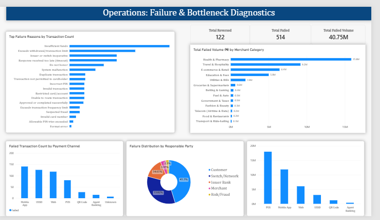
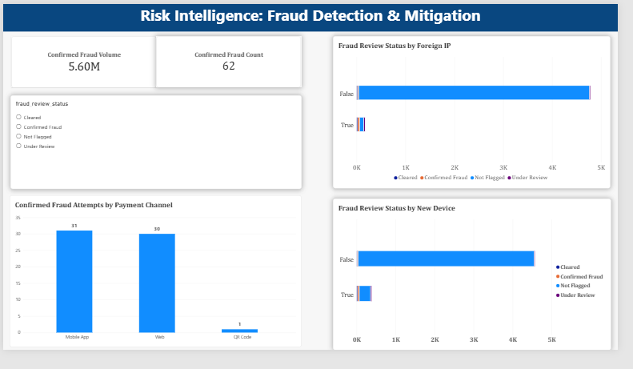

# 💳 NaijaPay Fintech: 2025 Transaction & Risk Diagnostic

## 📌 Executive Summary
In 2025, NaijaPay processed **₦131.8M** in successful transaction volume. On the surface, the platform is healthy, showing an **86.38%** overall success rate. 

However, a deep-dive diagnostic reveals a critical operational reality: **the platform lost ₦40.75M in failed transaction volume**—an amount that nearly rivals successful revenue. 

This project traces operational bottlenecks, KYC friction points, and fraud attack vectors back to their source using a full **Python → Power BI** pipeline. It moves beyond surface-level metrics to identify exactly which channels are failing, who is responsible (the Switch, the Bank, or the Customer), and where fraudsters are attempting to exploit the system.

> **The Core Question:** Is our 86% success rate masking a massive operational leak, and is our risk engine actually protecting our revenue?

---

## 🛠️ Tech Stack & Architecture
1. **Data Extraction & Cleaning (Python/Pandas):** Handled highly imperfect, messy raw data. Resolved duplicate rows, inconsistent date formats, mixed text casings (e.g., "P.O.S", "pos", "POS"), and text-disguised-as-numbers (e.g., "₦14,790.00"). Generated initial EDA charts via `matplotlib`.
2. **Data Modeling (Power Query & DAX):** Built a star schema connecting Transactions, Customers, Merchants, and Response Codes. Engineered custom DAX measures to isolate failed/reversed volume from successful revenue.
3. **Dashboard (Power BI):** Designed a 3-page interactive executive dashboard focusing on Executive Overview, Operations Diagnostics, and Risk Intelligence.

---

## 📊 The Dashboard Pages

### Page 1: Executive Performance Overview
*   **KPIs:** Total Successful Volume (₦131.8M), Total Fees, Success Rate (86.38%).
*   **Insights:** 
    *   **Retail Dominance:** Individual B2C users account for **81.74% (₦105.45M)** of all successful volume.
    *   **KYC Friction:** Tier 1 customers (lowest regulatory limits) have the **highest average transaction value (~₦47k)**. They are consistently bumping against their ₦50k ceilings.
    *   **Volume Drivers:** Travel & Hospitality (₦35M) and Education (₦25M) drive over 50% of platform volume.

### Page 2: Operations & Bottlenecks (Failure Diagnostic)
*   **KPIs:** Total Failed Volume (₦40.75M), Total Reversed Volume, Total Failed Count (514).
*   **Insights:**
    *   **The Switch Bottleneck:** The Switch/Network is responsible for **45.2%** of all failures.
    *   **Top Failure Reasons:** "Insufficient Funds" (Code 51) and "Limit Exceeded" (Code 61) are the top pain points.
    *   **Latency Issues:** POS terminals have the slowest processing times (12,000ms avg), directly correlating with high volumes of "Timeout" (Code 68) failures.
    *   **Channel Bleed:** Mobile App and USSD suffer the highest frequency of failures.

### Page 3: Risk Intelligence & Fraud Mitigation
*   **KPIs:** Confirmed Fraud Count (62), Confirmed Fraud Volume (₦5.6M).
*   **Insights:**
    *   **Attack Vectors:** Foreign IPs and New Devices show a disproportionate spike in confirmed fraud percentages. 
    *   **Target Channels:** Fraudsters are primarily targeting the **Mobile App (31 cases)** and **Web (30 cases)**. 

### 📸 Dashboard Visuals

**1. Executive Performance Overview**

**2. Operations & Failure Diagnostics**

**3. Risk Intelligence & Fraud Mitigation**

---

## 💡 Strategic Recommendations
1.  **Implement Real-Time Balance Checks:** To curb the #1 failure reason (Insufficient Funds), integrate a pre-transaction balance check API with major issuers.
2.  **Escalate Telecom/Switch Issues:** Operations must immediately open a ticket with Switch providers regarding the 45.2% failure rate and POS latency.
3.  **Review Tier 1 KYC Limits:** Introduce an in-app upgrade flow to Tier 2/3 to capture the high-velocity spending of Tier 1 users.
4.  **Tighten Risk Rules:** Enforce stricter OTP verification for high-value transactions originating from *foreign IPs* and *new devices*.
5.  **Q4 Infrastructure Scaling:** Scale server/API capacity ahead of the Nov/Dec holiday surge to prevent avoidable timeouts.

---

## 🛡️ Data Governance & Analytical Limitations

*   **Data Quality Filters:** 50 exact duplicate transactions and 25 duplicate customers were removed. However, 100 rows with `[Blank]` categorical data (e.g., missing KYC tiers) were retained to preserve transactional volume integrity but were excluded from demographic-specific visual filters.
*   **Visual Scaling:** Because confirmed fraud (62) is statistically tiny compared to legitimate volume (5,000), standard bar charts visually squash the fraud bars. Percentage-based (100% stacked) charts were deliberately used to display the *risk ratio*, while standard charts were used for absolute counts.
*   **Fee Reconciliation Scope:** While the dataset included a fee schedule, the logged fees did not perfectly align with theoretical tiered flat fees. The dashboard reports actual fees collected rather than reconstructing theoretical fees.
*   **Validation Rigor:** During the build phase, a sign error was caught in the Net Revenue Retention (NRR) DAX calculation. Rather than publishing an incorrect metric, it was excluded from the visual dashboard pending final validation in the Python environment.

---
